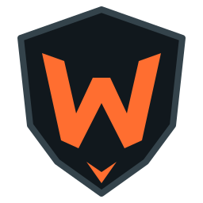
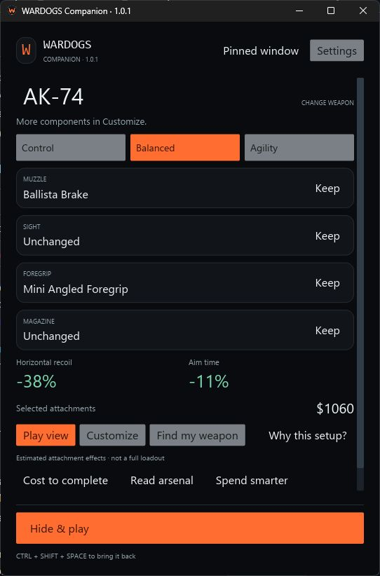
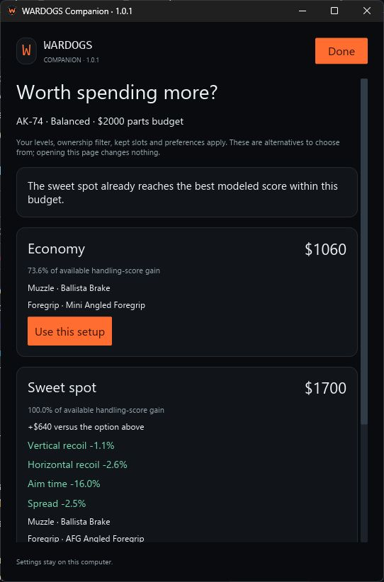
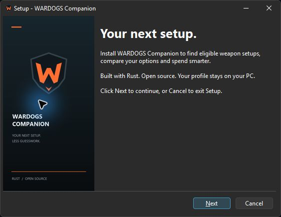

<div align="center">
  
  <h1>WARDOGS Companion</h1>
  <p><strong>Your next setup. Less guesswork.</strong></p>
  <p>A focused Windows companion for WARDOGS, built with Rust.<br />Find eligible weapon setups, compare your options and spend smarter.</p>
  <p>
    <a href="https://github.com/cccarv82/wardog-companion/actions/workflows/ci.yml"></a>
    <a href="https://github.com/cccarv82/wardog-companion/releases/latest"></a>
    <a href="LICENSE"></a>
    
  </p>
  <p><a href="https://github.com/cccarv82/wardog-companion/releases/latest"><strong>Download for Windows</strong></a> · <a href="#get-started">Get started</a> · <a href="CONTRIBUTING.md">Contribute</a> · <a href="https://github.com/cccarv82/wardog-companion/issues">Report an issue</a></p>
</div>

---

## Make the choice. Get back to playing.

Your levels decide what is eligible. Your budget decides what is practical. Your goal decides what to prioritize.

WARDOGS Companion brings those decisions into a compact panel you can keep above the game or hide with a shortcut. Set your progression once, choose a weapon, and get a supported setup for **Control**, **Balanced** or **Agility**. Open the details when you want the reasoning; keep them out of the way when you play.

**Native Rust + Iced. Offline recommendations. No account. English interface.**

<p align="center">
  
  
  <br /><sub>A real app screenshot. Spending gain is a model score, not measured combat performance.</sub>
</p>

## Features

| Question | What the companion does |
| --- | --- |
| **What can I use right now?** | Filters suggestions by your overall and infantry-role levels, explicit compatibility, budget and supported effects. |
| **What fits my playstyle?** | Builds around Control, Balanced or Agility, with optional kept parts, sight preference and magazine minimum. |
| **Which weapon should I pick?** | Compares supported weapons within a class for ideal kill time and stability; offers Close, Medium and Long range suggestions. |
| **Is spending more worth it?** | Shows distinct Economy, Sweet spot and Maximum alternatives, actual part lists and modeled handling trade-offs. Duplicate tiers collapse. |
| **What do I still need to buy?** | Separates remaining purchases from assumed unpaid unlock fees. Track owned parts and already-paid unlocks. |
| **What should I unlock next?** | Highlights a useful future attachment when the model finds one under your constraints. |
| **Did the patch affect me?** | Compares your selected weapon, parts and calculated suggestion across datasets without silently replacing your setup. |
| **Can I trust this dataset?** | Shows its build, source revision and coverage; validates updates before offering installation and retains a previous dataset for rollback. |
| **Can it stay out of my way?** | Provides a pinned panel, compact play view and a global hide/show shortcut. |
| **How do I keep the app current?** | Checks the official GitHub release on demand, downloads and verifies its installer, then lets you choose when to install. |

The pinned 1.0 catalogue contains **40 weapon records and 298 attachment records**. Two test/vehicle weapons are excluded from rankings. Complete catalogue coverage does **not** mean every attachment combination has a supported recommendation model.

### Experimental: read the arsenal

With the WARDOGS arsenal in the foreground, **Ctrl + Shift + R** can read a visible weapon name using local Windows OCR. You confirm the match before switching weapons. A supported Windows OCR language is required; resolution, overlapping windows and fullscreen capture can affect recognition. Manual selection is always available.

## Get started

1. Download **`WARDOG-Companion-1.0.1-Setup.exe`** from [Releases](https://github.com/cccarv82/wardog-companion/releases/latest). Install for your Windows user; administrator rights are not required. A portable ZIP is also available.
2. Set your **Overall, Assault, Medic, Recon and Support** levels and your attachment budget. Choose **Done**.
3. Pick a weapon and a goal. Use **Find my weapon** for a class/range recommendation or **Customize** to keep particular parts.
4. Choose **Hide & play**. Bring the panel back when you need it.

| Shortcut | Action |
| --- | --- |
| **Ctrl + Shift + Space** | Hide or show the companion |
| **Ctrl + Shift + R** | Read the foreground arsenal; experimental, confirmation required |

Only one interactive companion can run per Windows session. If it is already open, use Ctrl + Shift + Space to bring it back. Close older companion instances, including hidden ones, before opening this release. If another application owns a shortcut, the app reports it and Minimize remains available.

**Portable users:** extract the entire ZIP into a writable folder and open `wardog-companion.exe`. Keep `Data/` and `About/` with it. No installer, Python runtime or account is required to run the portable app.

### Installation and updates

- **Installer:** per-user installation, Start menu shortcut, optional desktop shortcut and standard Windows uninstallation. Uninstall requires the companion to be closed. Upgrades preserve the existing profile and external dataset.
- **App updates:** open **Settings → App updates**. Check, review the release notes, download, then choose **Install & close app**. Setup guides the installation. No startup polling or silent self-replacement.
- **Game-data updates:** open **Settings → Data & updates**. Review before installing. **Restore previous data** validates and restores the previous snapshot. This is separate from app updates.
- **Integrity:** the app accepts the expected installer asset from this repository, verifies its length and GitHub-provided SHA-256 digest, and checks it again before execution. Release downloads also include `SHA256SUMS.txt`.

**Version 1.0 is not digitally code-signed.** Windows may show an unknown-publisher or SmartScreen notice. Checksums verify file integrity; they do not replace publisher signing. If you prefer, inspect the source and build locally. Never disable Windows security to run the app.

Uninstalling leaves your local profile and retained external dataset in place. A portable copy is independent of an installed copy; close it before using the installed app.

<details>
<summary>Preview the Windows installer</summary>



</details>

## Understand the recommendations

The companion is a decision aid built from a **pinned community snapshot of game-file data**, not live player or server data. Missing values stay unknown. Compatibility is explicit; it is never inferred from caliber alone.

- **Ideal TTK** uses hypothetical target HP, ideal hits, published fire rate and supported distance falloff. The first hit is at time zero. Armor, body multipliers, misses, reloads, trigger/burst gaps and projectile flight time are outside the calculation.
- **Stability and handling** use supported attachment effects and source recoil statistics. They are not measured overall controllability.
- **Spending gain** is a weighted handling score relative to the cheapest feasible setup. The 70% and 95% thresholds are app policies, not percentages of accuracy or combat power.
- **Attachment budget** counts selected-part prices, including owned-part value. It excludes the weapon, unlock fees, ammunition and unchanged slots; remaining purchase cost answers a separate question.
- **Progression** is entered manually. Skills, armor, carried-weight modeling, Driver/Pilot progression and a full equipment optimizer are outside 1.0. The level input cap is 100.

See [modeling limits](MODELING_LIMITS.md), [source provenance](SOURCES.md) and [release validation](VALIDATION.md) for the precise boundaries. The model audit checks invariants; it is not an in-game accuracy certification.

## Your profile stays on your PC

Settings are stored at `%LOCALAPPDATA%\WardogCompanion\profile.json`. Installing a new version does not replace that file. There is one active setup; switching weapons clears weapon-specific selections while keeping shared progression and ownership.

Recommendations work offline. Network requests occur only when you explicitly check or download updates from GitHub. There are no accounts, analytics or image uploads. Experimental OCR processes a single image locally and cleans up temporary captures.

The app does not read game memory, inject code, modify game files or automate play. This does not imply official anti-cheat approval.

## Build from source

**Supported target:** Windows x64. Install [Rust with the MSVC toolchain](https://www.rust-lang.org/tools/install), Visual Studio C++ build tools and a Windows SDK containing `rc.exe`. Python 3 is needed only for importer development/tests; [Inno Setup 7](https://jrsoftware.org/isinfo.php) is needed only to build the installer.

```powershell
git clone https://github.com/cccarv82/wardog-companion.git
cd wardog-companion
cargo build --release --locked
.\target\release\wardog-companion.exe
```

The pinned catalogue, required source fixtures and icon resources are included. Building does not require downloading a fresh game-data snapshot. The build script embeds the executable icon and Windows version information. Set `RC` to the resource compiler path if your SDK is installed in a custom location.

### Validate a change

```powershell
New-Item -ItemType Directory -Force .local | Out-Null
cargo fmt --check
cargo clippy --all-targets --locked -- -D warnings
cargo test --release --locked
python tools/test_update_data.py
```

The native app can export a bundled-data model audit without opening the UI:

```powershell
.\target\release\wardog-companion.exe --audit-output .local\ranking-audit.json
```

[CONTRIBUTING.md](CONTRIBUTING.md) covers the PR workflow, project structure, UI principles and data changes. [Release engineering](docs/RELEASING.md) covers portable packaging and the installer.

## Contribute

Bug reports, clearer explanations, source-backed corrections and focused PRs are welcome. Start with [the contribution guide](CONTRIBUTING.md), check [open issues](https://github.com/cccarv82/wardog-companion/issues), and discuss larger changes before implementing them.

Our product rule is simple: **powerful decisions, minimal interruption.** New capabilities should earn their place on screen. Keep the main panel small; put supporting detail one step away.

Please follow our [Code of Conduct](CODE_OF_CONDUCT.md). Report security problems using [the security policy](SECURITY.md).

## Credits and license

Created by [Carlos Carvalho](https://github.com/cccarv82), with contributions welcome from the community.

- **App code and original artwork:** [MIT](LICENSE).
- **Primary game-data source:** [warpuppies/wardogs-data](https://github.com/warpuppies/wardogs-data), pinned to `e4ca3e9f1c48d980ba531202642884c358208304`, declared build `25937608`. Its [Unlicense](data/WARDOGS-DATA-LICENSE.txt) is included separately.
- **Supplemental compatibility research:** publicly observable WARDOGS WEAPONS comparisons, reviewed for this snapshot. Scope, unresolved joins and limitations are documented in [SOURCES.md](SOURCES.md).
- **Built with:** [Rust](https://www.rust-lang.org/), [Iced](https://iced.rs/) and [Inno Setup](https://jrsoftware.org/isinfo.php).

Game names, trademarks and underlying game content belong to their respective owners. This independent community project is not affiliated with BULKHEAD, Team17 or WARDOGS WEAPONS. Bundled data is not relicensed under the app's MIT license. No game binaries, icons or textures are distributed.
